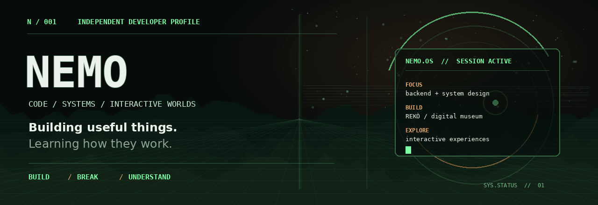

  

  
  &nbsp;
  

 

> **I like making things work — then understanding why they work.**  
> Full-stack developer leaning into backend engineering, system design, and the strange, exciting space where software becomes an experience.

 

<table>
  <tr>
    <td width="58%" valign="top">
      <h3>01 / THE CURRENT BUILD</h3>
      <strong>REKÒ — Digital Museum</strong> 
      A digital experience exploring Nigeria's history, culture, and the stories shaping its present. Building the product across the interface, API, and data layer.
        
      <code>React</code> <code>TypeScript</code> <code>Node.js</code> <code>PostgreSQL</code>
    </td>
    <td width="42%" valign="top">
      <h3>02 / IN THE LAB</h3>
      <ul>
        <li>Backend architecture &amp; system design</li>
        <li>Reliable APIs and data modelling</li>
        <li>Gaming &amp; interactive experiences</li>
      </ul>
    </td>
  </tr>
</table>

---

## `// toolkit`

  

## `// selected work`

<table>
  <tr>
    <td valign="top" width="50%">
      <h3>REKÒ ↗</h3>
      01 — CULTURE / INTERACTIVE STORYTELLING
      
A digital museum experience built to make Nigerian history easier to explore, connect, and understand.

      <code>React</code> <code>TypeScript</code> <code>PostgreSQL</code>
    </td>
    <td valign="top" width="50%">
      <h3>Personal Blog ↗</h3>
      02 — FULL-STACK / CONTENT
      
A full-stack blog with authentication, image uploads, and an admin workflow.

      <code>Express</code> <code>PostgreSQL</code> <code>Cloudinary</code>
    </td>
  </tr>
</table>

More experiments in progress. Only shipping what I can stand behind.

---

## `// signal`

  
  &nbsp;
  

  

---

  OUTSIDE THE TERMINAL
    
  🎮 Gaming, interactive worlds, and the technology that makes digital experiences feel alive.
    
  <samp>BUILD WITH INTENT. STAY CURIOUS. KEEP GOING.</samp>

