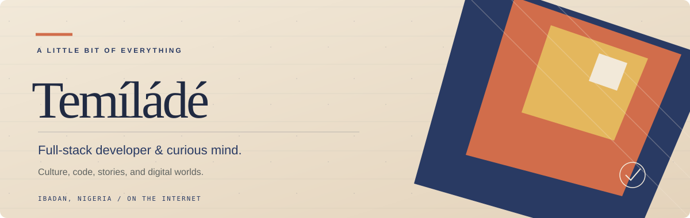

# Temilade — Full-stack Developer

  

  
  

I’m Temilade, a full-stack developer who enjoys turning ideas into useful, thoughtful digital experiences — from the way they look to the way they work.

## A few things I’m building

**[REKÒ](https://github.com/NemoCode-3011/Rekonekt-Frontend)**  
A digital museum exploring Nigerian history, culture, and the stories shaping the present.  
*React · TypeScript · Three.js · Node.js · PostgreSQL*

**[The Dystopian Architect](https://github.com/NemoCode-3011/thedystopianarchitect)**  
A personal publishing platform built around a considered reading experience.  
[Frontend](https://github.com/NemoCode-3011/thedystopianarchitect) · [Backend](https://github.com/NemoCode-3011/TDA-BACKEND)

**[BlackVault](https://github.com/NemoCode-3011/BlackVault-v1)**  
An interactive, security-themed experience with authentication and database-backed access.

**[Arcadia Homes](https://github.com/NemoCode-3011/arcadia-homes)**  
A real-estate concept focused on discovering properties through a polished interface.

## What I enjoy

Building across the stack, exploring visual ideas, learning how systems fit together, and making the details feel right.

  Made with curiosity · Ibadan, Nigeria

